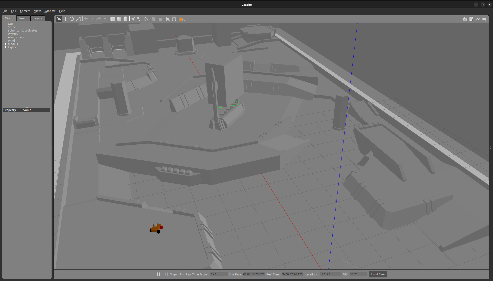
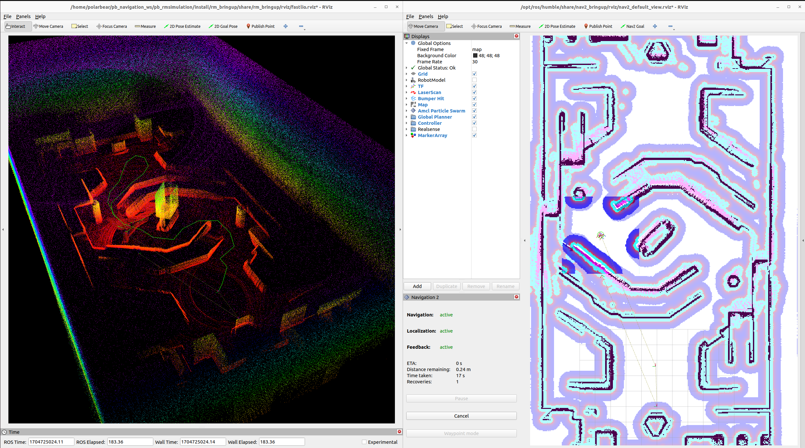
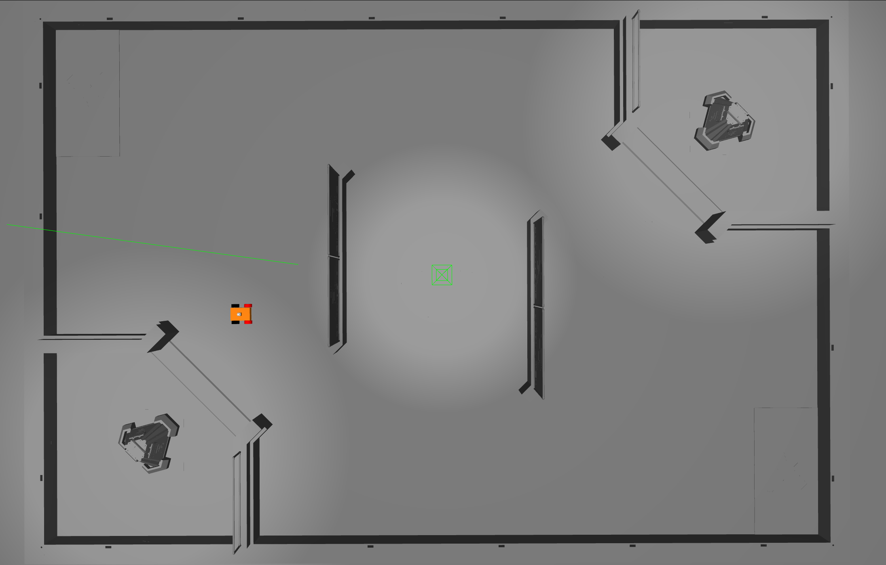
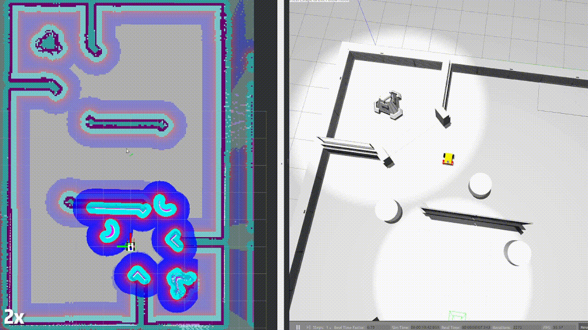
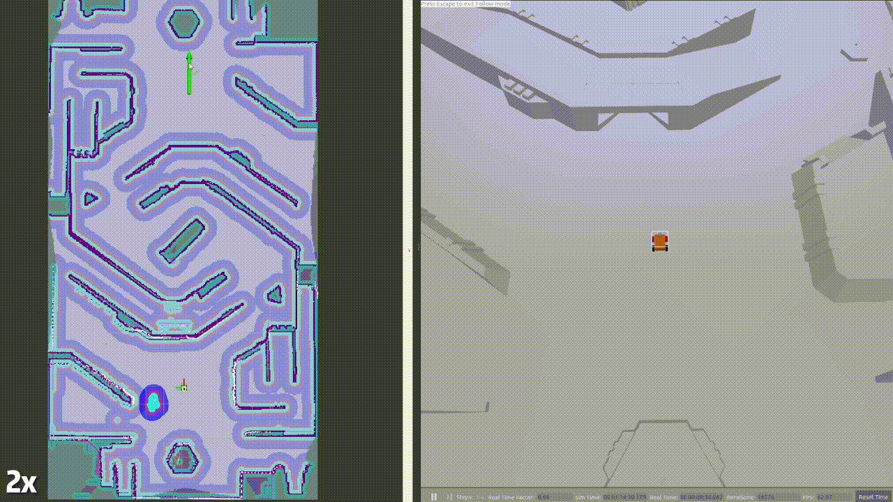

# 广州航海学院哨兵机器人导航算法

这是广州航海学院 RoboMaster 哨兵机器人的导航算法工作空间。项目以 ROS 2 Humble、Gazebo Classic 和 Navigation2 为基础，把激光雷达仿真、LIO 里程计、定位建图、全局规划、TEB 局部规划、代价地图和比赛决策行为树连接起来，覆盖从“传感器数据”到“底盘速度指令”的完整链路。

仓库同时保留了仿真和实车入口。仿真中可以复现 RMUL/RMUC 场地、动态障碍物、巡逻、目标追击和低血量回家等行为；实车端只需替换传感器、地图和底盘通信参数即可沿用同一套 Nav2 接口。

## 效果预览

| Gazebo 场地与机器人 | LIO 点云与 Navigation2 |
| :---: | :---: |
|  |  |

| RMUL 场地导航 | 动态避障 | 轨迹跟踪 |
| :---: | :---: | :---: |
|  |  |  |

## 系统总览

~~~mermaid
flowchart LR
    A[Gazebo / Livox Mid-360] --> B[点云与 IMU]
    B --> C[FAST-LIO 或 Point-LIO]
    B --> D[地面分割]
    D --> E[PointCloud2 转 LaserScan]
    C --> F[odom / TF]
    E --> G[SLAM Toolbox、AMCL 或 ICP]
    F --> G
    G --> H[Nav2 全局规划 + 代价地图]
    H --> I[TEB 局部规划器]
    I --> J[/cmd_vel]
    K[裁判系统串口] --> L[哨兵行为树]
    M[目标跟踪 /auto_aim_target_pos] --> L
    L --> N[/goal_pose 或急停]
    N --> H
~~~

导航链路的职责可以按下面的方式理解：

| 层级 | 当前实现 | 作用 |
| --- | --- | --- |
| 传感器仿真 / 驱动 | `pb_rm_simulation`、`livox_ros_driver2` | 提供 Mid-360 点云、IMU 和机器人运动仿真 |
| 状态估计 | FAST-LIO、Point-LIO、IMU complementary filter | 输出高频里程计和 `odom → lidar_odom` 相关 TF |
| 感知预处理 | linefit 地面分割、`pointcloud_to_laserscan` | 从三维点云提取障碍物与二维扫描 |
| 定位 / 建图 | SLAM Toolbox、AMCL、ICP registration | 建图、已知地图定位或点云初始配准 |
| 规划控制 | Nav2、Navfn、TEB、costmap | 规划可行路径，避障并输出速度 |
| 任务决策 | `icbk_sentry_bt`、`armor_chaser` | 根据比赛状态、血量和目标信息切换任务 |

## 决策行为树：仿真中能看到什么

默认行为树位于 [`sentry_behavior.xml`](src/icbk_sentry_bt/icbk_sentry_bt/behavior_trees/sentry_behavior.xml)，启动文件是 [`sentry_behavior_launch.py`](src/icbk_sentry_bt/icbk_sentry_bt/launch/sentry_behavior_launch.py)。它以反应式优先级结构运行，每次 tick 都会重新检查高优先级条件：

~~~mermaid
flowchart TD
    S[比赛阶段有效？] -->|否| W[等待并保持当前状态]
    S -->|是| H{低血量或电控要求回家？}
    H -->|是| R[发布回家点 /goal_pose]
    H -->|否| T{检测到目标？}
    T -->|是| P[发布当前位置为目标点 并向 /cmd_vel 发布 0 速度]
    T -->|否| O{血量足够且电控允许出家？}
    O -->|否| Q[保持当前位置或等待]
    O -->|是| Y[按高血量 / 低血量路线巡逻]
~~~

| 决策分支 | 代码中的条件 | 在仿真里的可观察现象 |
| --- | --- | --- |
| 比赛开始门控 | `IsGameStatus` | 行为树未进入任务前，机器人不会自动巡逻 |
| 低血量回家 | `LowHpLatched`、`IsEcDecisionGoHome` | `/goal_pose` 切换到 home 点，RViz 中出现回家路径 |
| 目标出现 | `IsTargetVisible` | 当前位姿被重新发布为目标，`/cmd_vel` 发布零速度，机器人急停 |
| 出家巡逻 | `IsEcDecisionGoOut`、`PatrolBetweenPoints` | `goal_pose` 在巡逻点之间循环，Nav2 规划路径并避障 |
| 血量分级路线 | `high_points`、`low_points`、`hp_switch_threshold` | 血量跨过阈值后切换巡逻路线；进入低血量阈值时让出导航 |
| 目标追击 | `armor_chaser` | 将目标位置、速度和朝向转换为追击点，持续更新 `navigate_to_pose` |

建议在仿真时同时打开 RViz 和以下监视终端，决策过程就可以被“显现”出来：

~~~bash
ros2 topic echo /goal_pose geometry_msgs/msg/PoseStamped
ros2 topic echo /cmd_vel geometry_msgs/msg/Twist
ros2 topic echo /referee/sentry_hp std_msgs/msg/UInt16
ros2 topic echo /referee/time_remaining std_msgs/msg/UInt16
ros2 topic echo /referee/home_arrived_flag std_msgs/msg/UInt8
~~~

`icbk_sentry_bt` 的裁判数据来自串口帧，因此纯 Gazebo 环境没有真实裁判机时，Nav2、巡逻、目标急停可以直接验证；血量、比赛阶段和电控出入家分支需要接入裁判串口或后续添加仿真裁判数据源。这个边界在 README 中明确标出，便于区分“导航仿真已运行”和“比赛决策输入已注入”。

## 主要功能包

| 功能包 | 说明 |
| --- | --- |
| [`rm_nav_bringup`](src/rm_nav_bringup) | 仿真 / 实车总启动，地图、点云、参数、RViz 和机器人模型 |
| [`pb_rm_simulation`](src/rm_simulation/pb_rm_simulation) | Gazebo Classic 场地、机器人模型、障碍物插件 |
| [`icbk_sentry_bt`](src/icbk_sentry_bt/icbk_sentry_bt) | 行为树主程序、裁判串口接收、巡逻与回家决策 |
| [`armor_chaser`](src/armor_chaser) | 基于装甲板跟踪结果的动态目标追击状态机 |
| [`goal_approach_controller`](src/goal_approach_controller) | 接近终点时限速并改善贴点效果的 Nav2 控制器包装器 |
| [`multi_point_navigation`](src/multi_point_navigation) | 将 `/goal_pose` 转发到 Nav2 `NavigateToPose` action |
| [`serpentine_patrol`](src/serpentine_patrol) | 通过多个路径点执行 S 形巡逻任务 |
| `rm_localization` | FAST-LIO、Point-LIO、ICP registration |
| `rm_navigation` | Nav2 启动、TEB local planner、costmap 和恢复行为 |
| `rm_interfaces` | 目标跟踪和裁判系统相关 ROS 2 消息定义 |

## 环境与依赖

已验证的基础环境：

- Ubuntu 22.04
- ROS 2 Humble
- Gazebo Classic 11
- `colcon`、`rosdep`、RViz2
- Livox SDK2（实车 Mid-360 驱动需要）

源码安装：

~~~bash
git clone --recursive https://github.com/Juice-cpu/ICBK_navigation.git
cd ICBK_navigation
source /opt/ros/humble/setup.bash
rosdep update
rosdep install -r --from-paths src --ignore-src --rosdistro humble -y
colcon build --symlink-install
source install/setup.bash
~~~

如果使用 VS Code Dev Container，可直接使用仓库中的 [`.devcontainer/devcontainer.json`](.devcontainer/devcontainer.json) 和 [`dockerfile`](dockerfile) 创建开发环境。首次编译建议保留 `--symlink-install`，这样修改 launch、参数或行为树后无需重复安装文件。

## 仿真快速开始

### 1. 启动 Gazebo、定位与 Nav2

RMUL 和 RMUC 是当前 Gazebo 启动文件支持的场地名称；`world`、`map` 和 `PCD` 文件使用同名命名约定。

~~~bash
source /opt/ros/humble/setup.bash
source install/setup.bash

ros2 launch rm_nav_bringup bringup_sim.launch.py \
  world:=RMUL \
  mode:=nav \
  lio:=pointlio \
  localization:=slam_toolbox \
  lio_rviz:=False \
  nav_rviz:=True
~~~

启动参数：

| 参数 | 可选值 | 说明 |
| --- | --- | --- |
| `world` | `RMUL`、`RMUC` | Gazebo 场地，并选择同名地图 / 点云资源 |
| `mode` | `nav`、`mapping` | 已知地图导航，或边建图边导航 |
| `lio` | `fastlio`、`pointlio` | 选择 LIO 里程计 |
| `localization` | `slam_toolbox`、`amcl`、`icp` | `mode:=nav` 时选择定位方式 |
| `lio_rviz` | `True`、`False` | 是否打开 LIO 点云 RViz |
| `nav_rviz` | `True`、`False` | 是否打开 Nav2 RViz |

边建图示例：

~~~bash
ros2 launch rm_nav_bringup bringup_sim.launch.py \
  world:=RMUL mode:=mapping lio:=pointlio \
  lio_rviz:=False nav_rviz:=True
~~~

### 2. 发布一个导航目标

先确认 `navigate_to_pose` action server 已启动，再发布地图坐标系下的目标点：

~~~bash
ros2 topic pub --once /goal_pose geometry_msgs/msg/PoseStamped \
  "{header: {frame_id: map}, pose: {position: {x: 2.0, y: -1.0, z: 0.0}, orientation: {z: 0.0, w: 1.0}}}"
~~~

在 RViz 中可同时观察地图、TF、全局路径、局部轨迹、局部代价地图和机器人位姿。仿真中的 Nav2 控制器当前使用 `teb_local_planner::TebLocalPlannerROS`；实车参数对速度、障碍物间距、前向行驶约束和膨胀区权重做了单独调整。

### 3. 启动行为树

行为树启动文件会读取裁判系统串口。实车默认使用 `/dev/stm32_serial`，也可以显式指定端口、波特率和 XML：

~~~bash
ros2 launch icbk_sentry_bt sentry_behavior_launch.py \
  behavior_tree_file:=$(ros2 pkg prefix icbk_sentry_bt)/share/icbk_sentry_bt/behavior_trees/sentry_behavior.xml \
  serial_port:=/dev/stm32_serial \
  baud_rate:=115200 \
  bt_tick_hz:=100
~~~

行为树运行时重点查看：

~~~bash
ros2 topic echo /goal_pose geometry_msgs/msg/PoseStamped
ros2 topic echo /cmd_vel geometry_msgs/msg/Twist
~~~

目标检测接口为 `rm_interfaces/msg/Target`，默认话题是 `/auto_aim_target_pos`。要验证“目标出现后急停”分支，需发布 `tracking: true` 的目标消息；要验证血量和比赛状态分支，需接入裁判串口帧。

例如，下面的消息可以在地图坐标系中模拟一个被跟踪目标，并观察 `/goal_pose` 与 `/cmd_vel` 的变化：

~~~bash
ros2 topic pub --once /auto_aim_target_pos rm_interfaces/msg/Target \
  "{header: {frame_id: map}, tracking: true, id: enemy, armors_num: 1, position: {x: 2.0, y: -1.0, z: 0.0}, velocity: {x: 0.0, y: 0.0, z: 0.0}, yaw: 0.0, v_yaw: 0.0, radius_1: 0.0, radius_2: 0.0, d_zc: 0.0, d_za: 0.0}"
~~~

### 4. 目标追击

Nav2 正常运行后，可以启动装甲板目标追击节点：

~~~bash
ros2 launch armor_chaser chase_state_machine.launch.py \
  goal_frame:=map \
  follow_distance:=0.5 \
  lost_timeout:=1.0 \
  replan_period:=0.3
~~~

节点会对目标位置和速度做前视预测、低通平滑，并在目标周围的 costmap 中选择可行追击点；目标短时丢失时保留预测，超过超时后取消 Nav2 目标。

## 实车启动与适配

实车启动入口：

~~~bash
ros2 launch rm_nav_bringup bringup_real.launch.py \
  world:=YOUR_WORLD_NAME \
  mode:=nav \
  lio:=pointlio \
  localization:=slam_toolbox \
  lio_rviz:=False \
  nav_rviz:=True
~~~

首次适配重点检查：

1. 在 [`MID360_config.json`](src/rm_nav_bringup/config/reality/MID360_config.json) 中填写雷达 IP 和外参。
2. 在 [`measurement_params_real.yaml`](src/rm_nav_bringup/config/reality/measurement_params_real.yaml) 中填写雷达相对 `base_link` 的位置。
3. 在 [`segmentation_real.yaml`](src/rm_nav_bringup/config/reality/segmentation_real.yaml) 中填写雷达离地高度。
4. 将同名的 `.yaml/.pgm` 地图放入 [`src/rm_nav_bringup/map`](src/rm_nav_bringup/map)，将 `.pcd` 放入 [`src/rm_nav_bringup/PCD`](src/rm_nav_bringup/PCD)。
5. 根据底盘尺寸和速度上限调整 [`nav2_params_real.yaml`](src/rm_nav_bringup/config/reality/nav2_params_real.yaml) 中的 `robot_radius`、TEB 速度、加速度和障碍物距离。
6. 启动 [`real_vel_transform`](src/rm_navigation/real_vel_transform) 将 Nav2 速度接口转换为底盘通信接口。

保存点云时，在 LIO 参数中打开 `pcd_save_en`，再调用：

~~~bash
ros2 service call /map_save std_srvs/srv/Trigger
~~~

## 常用接口

| 接口 | 类型 | 用途 |
| --- | --- | --- |
| `/livox/lidar` | `livox_ros_driver2/msg/CustomMsg` | Mid-360 原始点云 |
| `/livox/lidar/pointcloud` | `sensor_msgs/msg/PointCloud2` | ROS 2 点云 |
| `/livox/imu` | `sensor_msgs/msg/Imu` | 仿真或实车 IMU |
| `/Odometry` | `nav_msgs/msg/Odometry` | LIO 输出里程计 |
| `/scan` | `sensor_msgs/msg/LaserScan` | 点云转换后的二维扫描 |
| `/goal_pose` | `geometry_msgs/msg/PoseStamped` | 行为树 / 上层任务发送的导航目标 |
| `/cmd_vel` | `geometry_msgs/msg/Twist` | 底盘速度指令 |
| `/auto_aim_target_pos` | `rm_interfaces/msg/Target` | 目标跟踪结果 |
| `/referee/sentry_hp` | `std_msgs/msg/UInt16` | 哨兵血量显示 |
| `/referee/time_remaining` | `std_msgs/msg/UInt16` | 比赛剩余时间 |

## 排查顺序

- Gazebo 能启动但机器人不动：检查 `robot_description`、`/cmd_vel` 和底盘插件是否存在。
- Nav2 没有路径：检查定位是否发布 `map → odom`，目标是否落在地图可通行区域。
- 点云没有进入代价地图：依次检查 `/livox/lidar/pointcloud`、地面分割输出、`/scan` 和 TF。
- 行为树不巡逻：检查比赛阶段、裁判串口是否有有效帧，以及 `IsEcDecisionGoOut` 是否允许出家。
- 目标追击抖动：适当增大 `smoothing_alpha` 的滤波时间常数、`update_distance_threshold` 或调整 `follow_distance`。

## 参考与致谢

本项目使用并修改了 ROS 2 Navigation2、TEB Local Planner、FAST-LIO、Point-LIO、SLAM Toolbox、Livox ROS Driver 和 Livox Gazebo 仿真等开源项目。感谢开源社区提供的算法、驱动和场地模型，也感谢参与测试和交流的 RoboMaster 队伍。

## License

仓库根目录的 [`LICENSE`](LICENSE) 文件包含本项目当前许可证信息；各第三方功能包仍应遵循其各自上游仓库的许可证。
